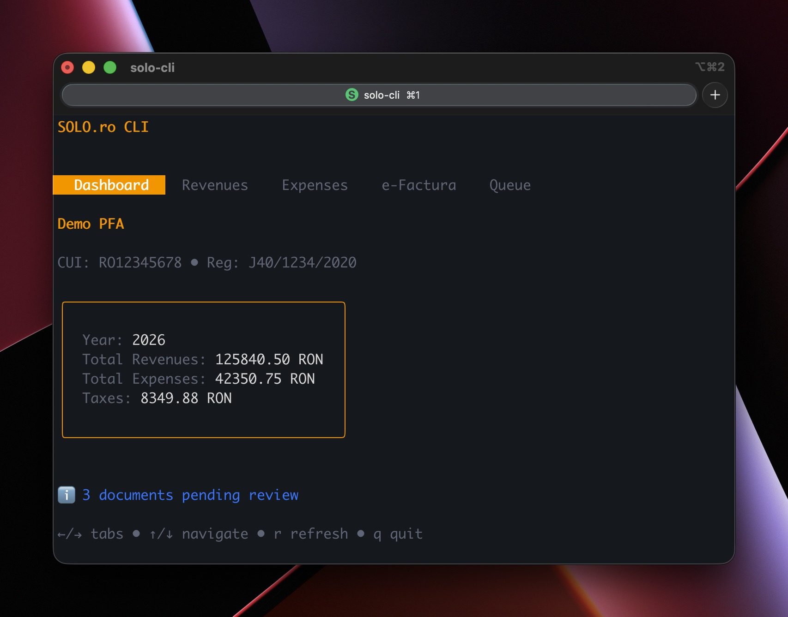
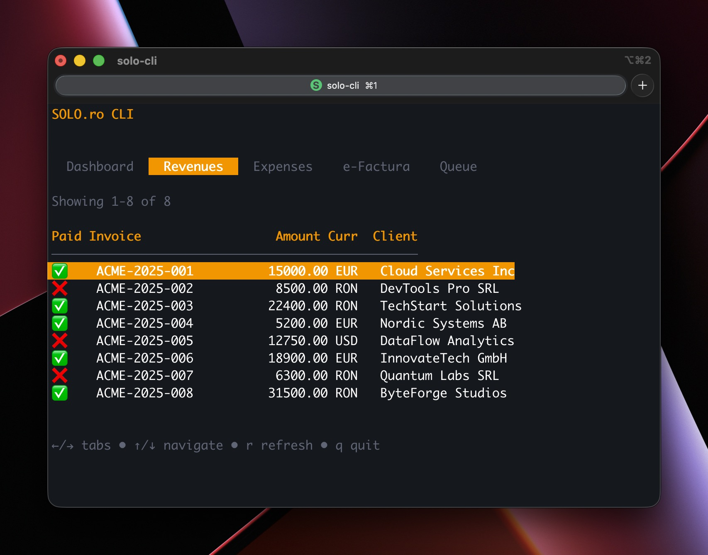
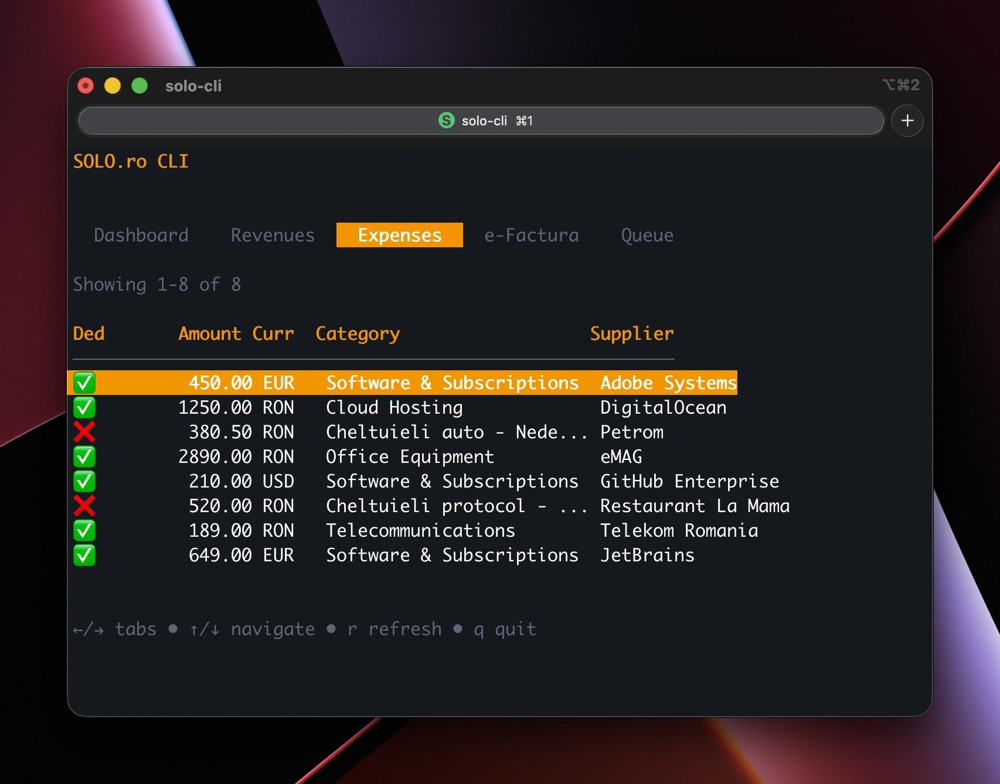
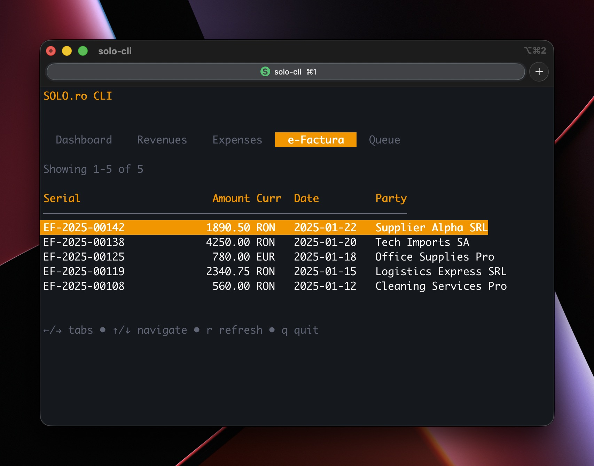
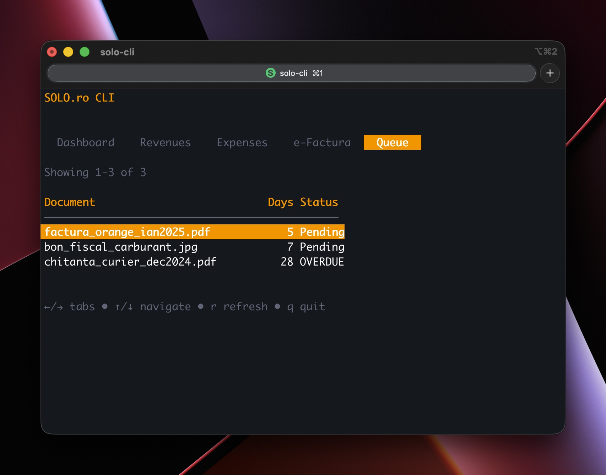
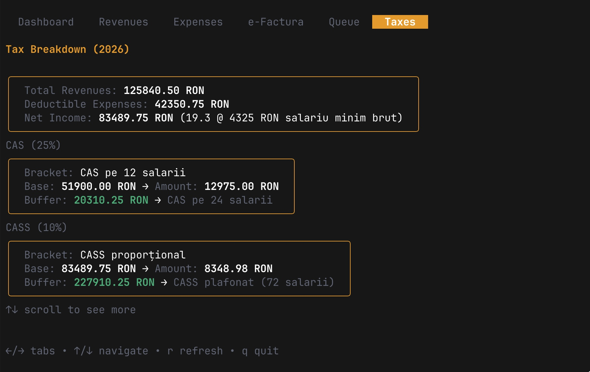

# Solo CLI

A terminal-based user interface for [SOLO.ro](https://solo.ro), an online accounting platform for Romanian freelancers (PFA).



## Features

- 🔐 Sign in through cont.solo.ro with two-factor authentication support
- 📊 Dashboard with company info and yearly summary
- 💰 View revenues and expenses
- 🧾 Invoice details, PDF and e-Factura XML downloads, mark paid or unpaid, delete the newest invoice
- 📄 e-Factura: received documents, the status of issued invoices, manual and early sending, sending preferences
- 📤 Upload expense and revenue documents (PDF, Images)
- 🗑️ Delete queued or rejected expense and revenue documents
- 📁 Filed declarations, Documente PFA and the cash flow register as files
- 🏛️ Declaratia Unica status with the filing deadline and account alerts (VAT threshold, CAEN, procura)
- 🏢 Company profile with VIES and bank accounts, subscription, referral, clients and BNR exchange rates
- 🍪 Cookie persistence for faster logins
- 🧮 Tax calculator with CAS/CASS/income tax breakdown and threshold buffers, compared with SOLO's own estimate

## Installation

### macOS (Homebrew)

```bash
brew install rursache/tap/solo-cli
```

### Windows / Linux / macOS (Go)

```bash
go install github.com/rursache/solo-cli@latest
```

### Build from Source

```bash
git clone https://github.com/rursache/solo-cli.git
cd solo-cli
go build -o solo-cli .
```

## Screenshots







## Configuration

On first run, the CLI creates a config at `~/.config/solo-cli/config.json`:

```json
{
  "username": "your_email@example.com",
  "password": "your_password",
  "page_size": 100,
  "user_agent": "Mozilla/5.0 (Windows NT 10.0; Win64; x64) AppleWebKit/537.36..."
}
```

| Field | Required | Description |
|-------|----------|-------------|
| username | Yes | SOLO.ro login email |
| password | Yes | SOLO.ro password |
| page_size | No | Number of items to fetch (default: 100) |
| user_agent | No | Custom HTTP user agent string |

The CLI signs in on cont.solo.ro and saves the session to `~/.config/solo-cli/cookies.json`. Accounts with two-factor authentication get a code prompt in the terminal and the device is remembered for 14 days. Scripts and cron jobs never trigger a code SMS on their own, run `solo-cli` once in a terminal when the session expires

### Tax Configuration

On first run of the `taxes` command (or TUI Taxes tab), the CLI creates `~/.config/solo-cli/taxes.json` with default 2026 values:

```json
{
  "year": 2026,
  "salariu_minim_brut": 4050,
  "income_tax_percent": 10,
  "cas_percent": 25,
  "cas_thresholds": [
    { "min_salaries": 0,  "max_salaries": 12, "base_salaries": 0,  "label": "Fără CAS (sub 12 salarii)" },
    { "min_salaries": 12, "max_salaries": 24, "base_salaries": 12, "label": "CAS pe 12 salarii" },
    { "min_salaries": 24, "max_salaries": 0,  "base_salaries": 24, "label": "CAS pe 24 salarii" }
  ],
  "cass_percent": 10,
  "cass_thresholds": [
    { "min_salaries": 0,  "max_salaries": 6,  "base_salaries": 6,  "label": "CASS minim (6 salarii)" },
    { "min_salaries": 6,  "max_salaries": 72, "base_salaries": -1, "label": "CASS proporțional" },
    { "min_salaries": 72, "max_salaries": 0,  "base_salaries": 72, "label": "CASS plafonat (72 salarii)" }
  ]
}
```

**Threshold fields:**
- `min_salaries` / `max_salaries`: income bracket bounds in multiples of SMB (`0` = unlimited)
- `base_salaries`: what to multiply by the percentage — positive = fixed multiple of SMB, `0` = exempt, `-1` = proportional (use actual net income)

`salariu_minim_brut` is the minimum gross salary in effect on January 1 of the income year (4050 RON for 2026, the July 2026 raise only counts from 2027 income). Update it each year and adjust thresholds as tax law evolves

## Usage

### Interactive TUI Mode

```bash
solo-cli
```

Navigate with keyboard:
- `Tab` / `←` `→` - Switch between tabs
- `↑` `↓` / `j` `k` - Navigate lists
- `d` - Delete item (Queue tab only)
- `r` - Refresh data
- `q` - Quit

**Tabs:** Dashboard → Revenues → Expenses → e-Factura → Queue → Taxes

### CLI Commands

```bash
# Overview
solo-cli summary                    # Account summary (current year), active alerts on stderr
solo-cli summary 2025               # Summary for specific year
solo-cli taxes                      # Tax breakdown plus SOLO's estimate (alias: tax)
solo-cli taxes 2025                 # Tax breakdown for specific year
solo-cli declaration                # Declaratia Unica status for last year (alias: du)
solo-cli alerts                     # Active account alerts

# Revenues and invoices
solo-cli revenues                   # List invoices, last column is the invoice code (alias: rev)
solo-cli revenues queue             # Revenue documents being processed
solo-cli revenues rejected          # Rejected revenue documents
solo-cli revenues delete 123 -y     # Delete a queued or rejected revenue document
solo-cli invoice <code>             # Invoice details with line items (alias: inv)
solo-cli invoice download <code>    # Save the PDF (--xml for e-Factura, --original for uploads)
solo-cli invoice paid <code> -y     # Mark paid today (or pass YYYY-MM-DD)
solo-cli invoice unpaid <code> -y   # Mark unpaid
solo-cli invoice delete <code> -y   # Delete the newest invoice

# e-Factura
solo-cli efactura                   # Received e-Factura documents (alias: ei)
solo-cli efactura status <invoice>  # e-Factura state of an issued invoice
solo-cli efactura send <invoice> -y # Send an invoice left on manual sending to ANAF
solo-cli efactura expedite <inv> -y # Send a scheduled e-Factura now
solo-cli efactura settings          # SPV connection and sending preferences
solo-cli efactura settings set --delay 0 --contact-info yes -y

# Expenses
solo-cli expenses                   # List expenses (alias: exp)
solo-cli expenses download <code>   # Save an expense document
solo-cli queue                      # Expense queue (alias: q)
solo-cli queue delete 123 -y        # Delete a queued or rejected expense document
solo-cli upload file.pdf            # Upload expense document (alias: up)
solo-cli upload -r invoice.pdf      # Upload revenue document

# Documents and account
solo-cli documents                  # Filed tax declarations (alias: docs)
solo-cli documents pfa              # Documente PFA files
solo-cli documents download <code>  # Save a declaration or PFA document
solo-cli report 2025                # Save the cash flow register PDF
solo-cli company                    # Company profile, VIES and bank accounts
solo-cli subscription               # SOLO.ro subscription
solo-cli referral                   # Referral link and rewards
solo-cli clients [search]           # Clients (alias: customers)
solo-cli rates [YYYY-MM-DD]         # BNR exchange rates
```

Commands that change data (delete, mark paid or unpaid, e-Factura sending, settings) ask `[y/N]` on a terminal and need `--yes` (`-y`) in scripts. Downloads save to the current directory, `-o` picks a path or directory and `-f` allows overwriting an existing file

### Global Options

```bash
solo-cli --help           # Show help
solo-cli --version        # Show version
solo-cli -c /path/to/config.json summary  # Use custom config
```

### Examples

```bash
# Pipe to grep
solo-cli expenses | grep -i "food"

# Use custom config
solo-cli -c ~/work.json revenues

# View past year
solo-cli summary 2024
```

Output is tab-separated for piping to other tools. New columns are only ever appended at the end of a line

## AI Skills

This project also provides a "skill" for agentic AI tools, allowing AI assistants to interact with SOLO.ro on your behalf:

- **GitHub**: [skill folder](https://github.com/rursache/solo-cli/tree/master/skill)
- **ClawdHub**: [rursache/solo-cli](https://clawdhub.com/rursache/solo-cli)

## Acknowledgments

This entire codebase was created using [Claude Opus 4.5](https://www.anthropic.com/claude) and [Claude Opus 4.6](https://www.anthropic.com/claude). Issues and PRs are welcome.

## License

MIT License - see [LICENSE](LICENSE) for details
